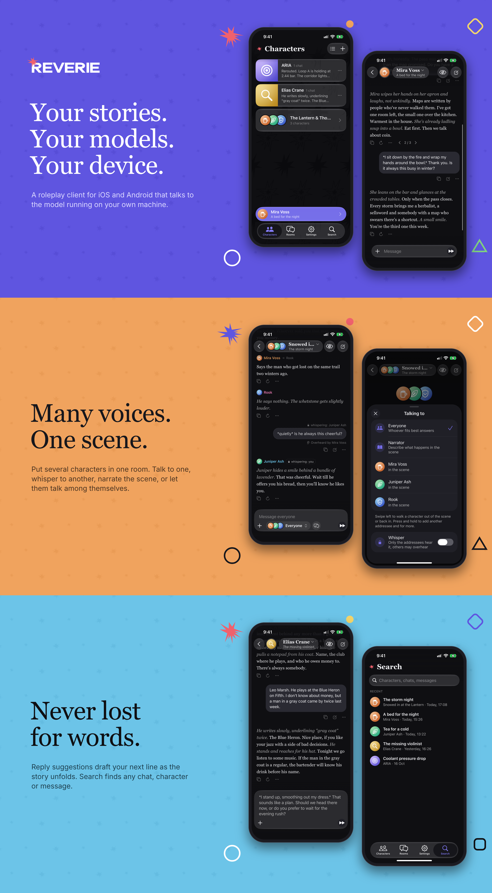

<p align="center">
  
</p>

<p align="center">
  Roleplay chat client for iOS and Android, built with Expo.<br />
  It talks directly to a local model server over an OpenAI-compatible API (LM Studio, llama.cpp, Ollama). All data stays on the device.
</p>

<p align="center">
  <a href="https://github.com/meltedkeyboard/reverie/releases/latest"><b>Download</b></a> ·
  <a href="#install">Install</a> ·
  <a href="#features">Features</a> ·
  <a href="#quick-start">Build from source</a>
</p>

## Install

1. Download the `.ipa` (iOS) or the `.apk` (Android) from the [latest release](https://github.com/meltedkeyboard/reverie/releases/latest).
2. On iOS, sign and install the `.ipa` with Sideloadly or AltStore using your Apple ID (a free account gives a 7-day signature). On Android, open the `.apk` and allow installing from this source.
3. Start a model server on your computer (LM Studio, llama.cpp, Ollama or anything OpenAI-compatible), then enter its address in Settings, for example `http://192.168.1.10:1234`.

Character cards from other apps (V1, V2, V3; JSON or PNG) import with the download button on the Characters tab.

## Features

- Characters act as templates: each one can have any number of chats. A new chat starts with the character's greeting. The system prompt and generation parameters come from the character, so editing it affects all of its chats.
- Streaming replies, with variants: any reply can be regenerated and the new one is added as a `< 2/3 >` variant. Later messages stay in place and following replies are built on the selected variants.
- "Refine..." regenerates a reply with a user wish ("sadder", "more surprise"). The wish is appended to the last user message as `(OOC: ...)` for that request only and is not saved.
- Reasoning models: thoughts are shown live above the reply and stay collapsed afterwards. They are stored per variant and never sent back to the model. Supports the `reasoning_content` and `reasoning` stream fields and a leading `<think>` tag.
- Photo attachments, downscaled to 1024 px and stored as JPEG files. Sent in the OpenAI `image_url` format, so the model must support vision. Taken from the camera, Photos, Files, the latest pictures sent or the character's gallery (Settings can hide the last two).
- There is no limit on how many pictures a message takes, but every picture still in the context window is sent again with each reply and costs the model tokens: about 256 for Gemma 3, over a thousand for Qwen2.5-VL at 1024 px (the context counter assumes 700). Some servers and models also cap the number of images per request. Three to five at a time work almost anywhere; twenty may overflow the window, be refused, or make the reply slow to start.
- Rooms: several characters in one scene. Pick who you talk to, whisper to some of them (others may overhear), or narrate the scene. The floor mode decides who else may speak: only the addressee, the addressee plus short reactions, or an open floor where characters cut in on topics that concern them and answer each other by name. A short director request settles close calls. "Let them talk" runs a dialogue between the characters without you. Members can listen only or step out of the scene and come back later, knowing only what they heard. With the director on, characters leave by themselves, throw each other out and let each other in, and the narrator can take anyone out or bring them in. A one-on-one chat can be moved into a new room or one that already exists.
- Character Card import (V1, V2, V3; JSON or PNG): the download button on the Characters tab, from Files or from Photos (a PNG). The description, personality, scenario and system prompt become the prompt, the first message the greeting, the PNG the avatar. Its lorebook becomes a lorebook of the new character. Alternate greetings and example dialogue are not imported yet. "Export card" (in a character's menu and on the character screen) saves a PNG of the avatar with the V2 card inside to Files or to Photos; other card apps import it too.
- Chat titles: set manually or generated by the model (automatically after the first reply, or via "Come up with a title" in the chat menu).
- System prompt generator: drafts or improves a character prompt with the connected model.
- Room generators: the scene description and the opening of a room, and "Set up with AI", which sets up the whole room from a few words ("a party; Kyle and Radan are friends and can't stand Dylan; Elara is an introvert"): the scene with its relationships, the opening, the floor, and each member's talkativeness, perception and triggers. Characters of your list named in the words join the room. It also writes each member's feelings and secrets, the plot twists, and makes the characters you name who don't exist yet. The result is a readable setup sheet you can edit or refine before it fills in the editor.
- Branches: "Branch from here" on any message starts a new chat (or scene) that goes on from it, the original left as it was.
- Direction: a standing note to the model per chat or scene (where the story goes, the tone, the pace), sent with every reply until cleared; in the chat's menu.
- Long memory (optional, Settings > Memory and lore): what no longer fits the context window is summed up and kept in the prompt, so the characters remember the start of a long story; the summary can be read and corrected from the chat's menu.
- Lorebooks: entries about the world that go into the prompt only while their keys come up in the talk, tied to characters and rooms; a card's lorebook comes in with the card.
- Living rooms: each member can have a secret only they know, and feelings about the others that the director keeps up as the story goes, across the room's scenes. The director also notes where the scene stands (shown above the field while nobody talks), and with plot twists on, the narrator brings in an event when the talk stalls.
- Animated avatars: GIF, animated WebP/APNG and MP4/MOV/M4V (looping, muted), up to 15 MB. Picked from Photos or Files like any picture; kept as they are and shown by their middle.
- Per-character chat backgrounds with effects and adjustable bubble transparency.
- Private questions: the eye in a chat or a scene asks the model about it aside, like `/btw` — it reads the chat and answers out of character, and nothing is saved or seen by the characters.
- Reply suggestions (off by default, Settings > Chats): after a reply the model drafts your next message in gray in the field, streaming as it is written. Swipe the field right to type it in, left to dismiss it until you reopen the chat.
- Toasts: notices in Settings (backup, sync push and pull, errors) slide in from the top over the screen instead of blocking it with an alert.
- App icon: nine alternates to the standard one (Settings > App icon), on iOS and Android. Not available in Expo Go.
- Haptics toggle, "Continue" capsule on the home screen that jumps to the last active chat.
- Backup export and import as a zip (JSON files for characters, rooms and chats, the pictures as they are; the API key is not included). Older single-file JSON backups still import.
- Folder sync (not in Expo Go): the data is kept in a folder you pick (iCloud Drive, Google Drive, any other storage or a local folder) and picked up by the other devices, on iOS and Android. Works with an app signed by a free Apple ID, see below.
- English and Russian UI.
- iOS 26 Liquid Glass UI where available, with a plain fallback on older iOS and on Android.
- Android: the same app without the iOS-only parts. The iOS menus and action sheets are drawn in React Native, and the "show in Files" toggle is absent.

## Quick start

```
npm install
npx expo start
```

Open the app in Expo Go and set the server address in settings, for example `http://192.168.1.10:1234`. A trailing `/v1` is stripped. The API key is optional.

Other scripts: `npm run typecheck`, `npm run icons` (renders icons from `assets/brand` into `assets/images/`; also runs on `postinstall`).

## Building an .apk

GitHub Actions builds `Reverie.apk` (`.github/workflows/android.yml`) the same way: run it from Actions > Android build, or push a `v*` tag. The file is signed with the debug key of the Expo template, which is enough to install it by hand. Locally: `npx expo prebuild -p android`, then `npx expo run:android` (needs the Android SDK and JDK 17 or 21).

Plain `http://` addresses of a model server on the local network work, cleartext traffic is allowed in the build.

## Building an .ipa

An unsigned `Reverie.ipa` is built by GitHub Actions (`.github/workflows/ios.yml`). Run it manually from Actions > iOS build > Run workflow, or push a `v*` tag to also attach the file to a release. Otherwise the file is in the run artifacts.

Sign and install it with Sideloadly or AltStore using your Apple ID. A free account gives a 7-day signature.

To build locally on a Mac, run `./tools/build-ipa.sh` (needs Xcode, CocoaPods, Node 24).

## Desktop client (Electron, experimental)

The same code runs on Windows, macOS and Linux: Expo builds it as a web app (`react-native-web`) and Electron puts it in a window (`electron/`). There is no second codebase; where the web differs from the phone, a `*.web.ts(x)` file or a `Platform.OS === 'web'` branch sits next to the original, and `expo-file-system` is replaced on the web by `src/web/expo-file-system.ts` (see `metro.config.js`). Not every screen is adapted yet.

Needs only Node 24, no other toolchain.

```
npm install
npm run desktop
```

`npm run desktop` (`tools/desktop-dev.mjs`) starts Metro on port 8081, waits for it and opens the window; edits to `src/app/` and `src/` reload live. If the port is busy it says so and stops, close the old `expo start` first.

To run the production build without making an installer: `npm run desktop:preview`. To make one: `npm run desktop:build`; it runs `expo export -p web`, then electron-builder (the `build` key of `package.json`) writes an NSIS installer, a `.dmg` or an AppImage into `release/`. Build on the system you build for.

In the built app the page is served from `app://` by `electron/main.js` with cross-origin isolation, which the SQLite worker needs.

Data (the database and the images) is for now kept in the browser storage of the app profile (OPFS and IndexedDB), under `%APPDATA%Reverie` on Windows, so it is not visible in a file manager. Dev and the built app use different origins and so different data. Use Settings > Backup to move it between them.

## Project layout

- `src/app/` - screens (expo-router): character list, character chats, chat, character editor, chat background, settings, onboarding, image viewer.
- `src/api/llm.ts` - server requests, SSE parsing, context window (`CONTEXT_WINDOW`, 20 messages).
- `src/hooks/` - `useChat` (conversation state and streaming), `useRoom` (group scenes) and smaller UI hooks.
- `src/lib/chat/room/` - room logic: who speaks next, who hears what, the director request, each speaker's view of the scene.
- `src/db/` - expo-sqlite schema and queries (`characters`, `chats`, `messages`, `app_settings` and per-feature flags).
- `src/lib/` - avatars, backup, dialogs, prompt generation, `*action*` parsing, haptics.
- `src/components/` - UI components.
- `src/locales/` - `en.json` and `ru.json`. `src/locales/permissions/ru.json` holds localized iOS permission strings.

A detailed map of the code (where to change what, data flow, conventions) is in [CODEBASE.md](CODEBASE.md).

## Implementation notes

- Streaming uses `fetch` from `expo/fetch`, because the React Native `fetch` does not expose the response body incrementally.
- Native menus (the "+" button, the message "..." menu, the chat title capsule) are SwiftUI `Menu` from `@expo/ui`. The button is drawn by React Native and embedded via `RNHostView`, so the menu morphs out of the button. Without the `ExpoUI` module (Expo Go) an action sheet is shown instead (`src/components/overlays/NativeMenu.tsx`).
- Native modules for the glass UI are loaded in `src/lib/ui/nativeUI.ts` only if they exist in the build.
- The database lives in iOS Documents. Avatars are files, the database stores only the file name.
- Plain HTTP servers are allowed through `NSAllowsArbitraryLoads` in `app.json`.
- A chat where the user wrote nothing is deleted when returning to the list.
- The "Continue" capsule state is stored in `app_settings` (`src/db/prefs/continue.ts`).
- Folder sync does not use the iCloud entitlement (CloudKit or an app container), which a free Apple ID cannot sign. The user picks a folder through the system picker instead (the document picker on iOS, the folder picker of the Storage Access Framework on Android), and the app keeps a bookmark or a persisted permission for it (`modules/reverie-cloud-folder`). The whole database and the pictures go there as a snapshot; when both devices changed since the last sync, the user picks which copy wins.
